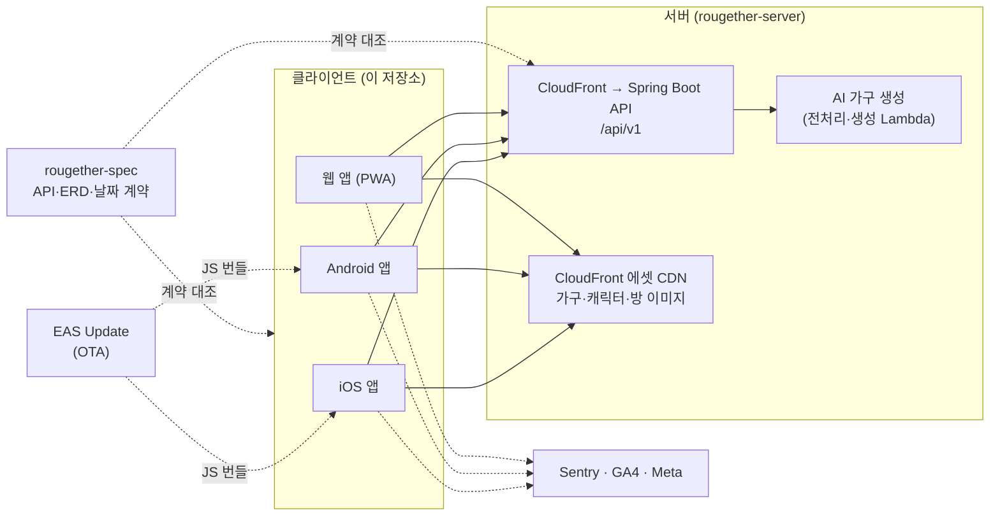
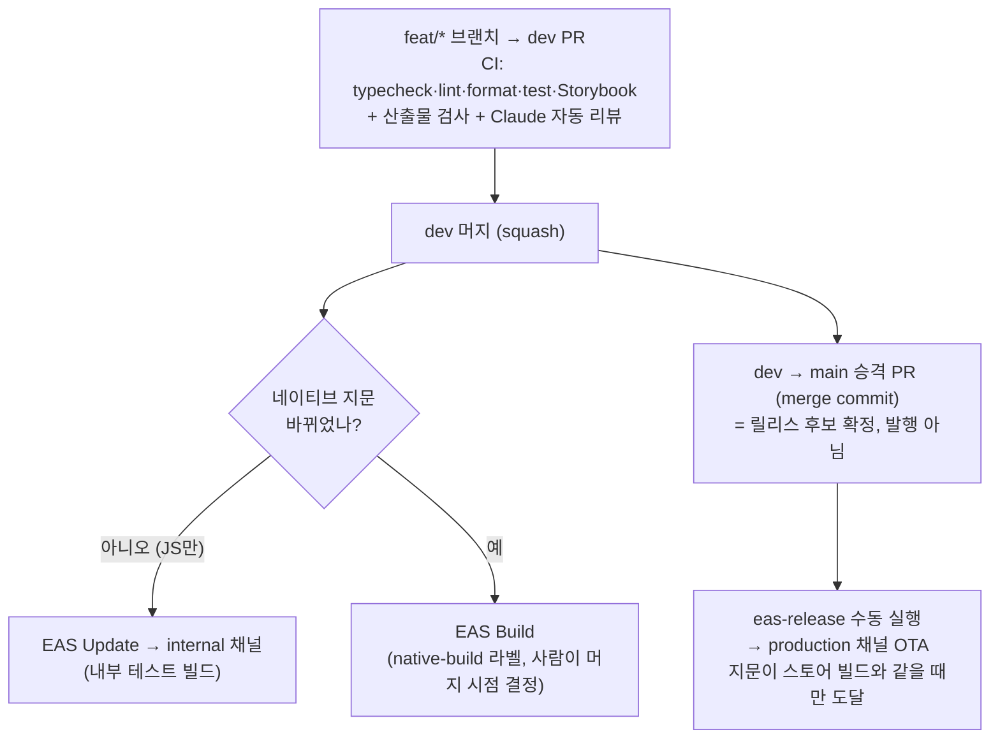

# **루게더 (Rougether)**

[](https://docs.expo.dev/versions/v55.0.0/)
[](https://reactnative.dev/)
[](https://www.typescriptlang.org/)
[](https://apps.apple.com/app/id6793513720)
[](https://play.google.com/store/apps/details?id=com.triples.rougether)
[](.github/workflows/ci.yml)

## 📋 프로젝트 개요

**루게더**는 친구들과 한 집에 모여 서로의 하루를 응원하며 루틴을 지키는 **루틴·습관 트래커 + 방 꾸미기 게임**입니다.
루틴을 끝내면 코인을 받고, 그 코인으로 가구를 뽑아 내 방을 꾸밉니다. 친구·가족과 만든 "집"에서는 서로의 방을 구경하고, 공동 미션으로 집을 함께 키웁니다.

AI·SW마에스트로 제17기 프로젝트(팀 tripleS)이며, 이 저장소는 **iOS·Android·웹 앱**입니다. 서버(Spring Boot)와 API·도메인 계약(spec)은 별도 저장소에 있습니다.

- **다운로드**: [App Store](https://apps.apple.com/app/id6793513720) · [Google Play](https://play.google.com/store/apps/details?id=com.triples.rougether) · [웹 앱](https://app.rougether.com)
- **소개 사이트**: [rougether.com](https://rougether.com)

### 🎯 핵심 특징

- **루틴 완료가 눈에 보이는 성장으로**: 루틴·할 일 완료 → 코인 → 가구 뽑기 → 내 방 꾸미기. 성취가 매일 방에 쌓입니다.
- **지인 기반 공동체**: 친구와 "집"을 만들고, 서로의 방을 구경하고, 응원하고, 공동 미션을 함께 달성합니다.
- **AI 가구 만들기**: 사진 한 장으로 내 방에 놓을 가구를 만들고, 직접 쓰거나 거래소에 올립니다.
- **하나의 코드로 세 플랫폼**: Expo(React Native)로 iOS·Android·웹을 함께 운영하고, JS 변경은 스토어 심사 없이 OTA로 배포합니다.
- **운영 중인 서비스의 릴리스 안전장치**: 네이티브 지문으로 OTA와 빌드를 자동 구분하고, 산출물 검사·실행 스모크·날짜 계약 테스트로 "빌드는 됐는데 안 켜지는" 릴리스를 막습니다.

### 📊 프로젝트 정보

| 항목      | 내용                                                                         |
| --------- | ---------------------------------------------------------------------------- |
| 개발 기간 | 2026.06.26 ~ (운영 중)                                                       |
| 참여      | 팀 tripleS — 모바일 앱은 최준서가 주로 개발(머지 커밋 제외 1,046개 중 994개) |
| 규모      | 커밋 1,364개, 머지된 PR 1,050개 (2026-11-09 기준)                            |
| 배포      | App Store · Google Play · 웹(GitHub Pages)                                   |
| 현재 버전 | 1.5.5                                                                        |

<details>
<summary><b>📝 주요 이정표</b></summary>

| 시기       | 내용                                                                                                             |
| ---------- | ---------------------------------------------------------------------------------------------------------------- |
| 2026.06.26 | 개발 시작 — 웹 프로토타입(Figma Make)의 화면을 Expo로 포팅                                                       |
| 2026.08    | 1.2.0 — 기기 캘린더 가져오기. 출시 직전 시작 크래시를 산출물 검사로 막는 체계를 세움                             |
| 2026.09.16 | 1.5.3 네이티브 윈도우 — 홈 위젯 표정 등                                                                          |
| 2026.09    | i18n(한국어·영어) 전환, Storybook 테스트 파이프라인, 관측(Sentry·GA4) 정비                                       |
| 2026.09~10 | 피드·가구 거래소 연동, 버전 게이트(OTA 레인 이탈 설치본 안내)                                                    |
| 2026.11.04 | 1.5.5 — Meta SDK·ATT(설치 광고 측정), 눌림 피드백                                                                |
| 2026.11.08 | 릴리스 사전 검사를 오픈소스 CLI [expo-release-guard](https://github.com/evan7484/expo-release-guard)로 분리·배포 |
| 2026.11.09 | 캐릭터 대기 동작, 캐릭터 스타일 가이드, 뽑기 화면 문구 정리                                                      |

</details>

## 🛠 기술 스택

| 분류                  | 기술                                                                                | 용도                                                  |
| --------------------- | ----------------------------------------------------------------------------------- | ----------------------------------------------------- |
| **앱**                | Expo SDK 55 · React Native 0.83 · React 19.2 · TypeScript(strict)                   | iOS·Android·웹 단일 코드베이스                        |
| **라우팅**            | Expo Router 55                                                                      | 파일 기반 라우팅, 딥링크(초대·위젯)                   |
| **서버 상태**         | TanStack Query 5                                                                    | 캐시·무효화·포커스 재조회                             |
| **애니메이션·제스처** | Reanimated 4 · Gesture Handler 2.30                                                 | UI 스레드 애니메이션, 방 꾸미기 편집기 제스처         |
| **이미지**            | expo-image                                                                          | CDN 에셋·애니메이션 webp                              |
| **다국어**            | i18next                                                                             | 한국어·영어, 키 누락·보간 불일치를 테스트로 차단      |
| **관측**              | Sentry · Firebase Analytics(GA4) · Meta SDK                                         | 오류·성능, 행동 분석, 설치 광고 측정                  |
| **테스트**            | Jest(jest-expo) · React Native Testing Library · Storybook 10 + Vitest + Playwright | 단위·화면, 브라우저 렌더·접근성·시각 회귀             |
| **빌드·배포**         | EAS Build · EAS Update(fingerprint 런타임) · GitHub Actions                         | 네이티브 빌드, OTA, CI·릴리스 자동화                  |
| **릴리스 검사**       | [expo-release-guard](https://github.com/evan7484/expo-release-guard)                | prebuild 산출물(Info.plist·매니페스트·앱 아이콘) 검사 |
| **서버(별도 저장소)** | Spring Boot 4.1 · Java 25                                                           | REST API, 관리자, 배치, AI 가구 생성 파이프라인       |

## 🏗 시스템 아키텍처



- **화면은 순수 컴포넌트**: 화면은 prop으로 데이터와 콜백만 받고, 라우팅·데이터 패칭·전역 상태는 앱 셸이 연결합니다. 그래서 같은 화면을 Dev 갤러리와 Storybook에서 그대로 띄워 테스트합니다.
- **디자인 토큰 단일 출처**: 색·간격·모서리·타입 스케일을 [`src/constants/theme.ts`](src/constants/theme.ts) 한 곳에서 관리합니다. 테마 5종·라이트/다크·글꼴 5종을 런타임에 바꿀 수 있습니다.
- **계약 우선**: 스웨거는 "지금 서버에 있는 것", spec 저장소는 "팀이 합의한 의도"입니다. 날짜(`YYYY-MM-DD`는 항상 Asia/Seoul 달력 날짜) 같은 계약은 앱과 서버가 같은 fixture로 각자 검증합니다.

### 배포 아키텍처



- **승격 ≠ 발행**: 심사 중인 빌드도 production 채널을 듣기 때문에, main 승격이 곧 "심사자가 보는 코드를 바꾸는 일"이 되지 않도록 운영 OTA는 수동 발행만 합니다.
- **지문이 OTA를 지킨다**: `package.json`의 scripts 한 줄이나 `app.json` 수정도 런타임 지문을 바꿔 기존 설치본의 OTA를 끊습니다. 그래서 이런 변경은 네이티브 빌드 윈도우에 모아서 냅니다. 자세한 절차는 [`docs/release-ops.md`](docs/release-ops.md)에 있습니다.

## 📁 프로젝트 구조

| 경로                                                | 역할                                                                                       |
| --------------------------------------------------- | ------------------------------------------------------------------------------------------ |
| [`src/app/`](src/app)                               | Expo Router 라우트. `(tabs)/`가 앱 셸, `_layout.tsx`가 루트 Stack, 로그인·초대·위젯 딥링크 |
| [`src/components/screens/`](src/components/screens) | 화면 컴포넌트. **순수·prop 기반**(라우팅·전역 상태 없음) + 형제 테스트                     |
| [`src/components/app/`](src/components/app)         | 앱 셸 — 탭 페이저, 내비게이션, 화면 배선                                                   |
| [`src/components/ui/`](src/components/ui)           | 공용 프리미티브(바텀시트·토스트·달력·휠 피커 등)                                           |
| [`src/components/room/`](src/components/room)       | 방 렌더러·캐릭터·가구                                                                      |
| [`src/hooks/`](src/hooks)                           | 데이터 훅(react-query), `useTokens()`·`useTypography()`·`useFontEmphasis()`                |
| [`src/api/`](src/api)                               | API 클라이언트(`/api/v1`)와 DTO → 앱 모델 어댑터                                           |
| [`src/constants/theme.ts`](src/constants/theme.ts)  | **디자인 토큰 단일 출처**                                                                  |
| [`src/i18n/`](src/i18n)                             | 한국어 원문·영어 번역(도메인별 JSON)                                                       |
| [`src/widgets/`](src/widgets)                       | 홈 화면 위젯                                                                               |
| [`src/dev/registry/`](src/dev/registry)             | Dev 탭 컴포넌트 갤러리                                                                     |
| [`stories/`](stories) · [`.storybook/`](.storybook) | 웹 Storybook(렌더·상호작용·접근성·시각 회귀)                                               |
| [`store/`](store)                                   | 스토어 리스팅 문구의 단일 출처(글자 수·제거된 기능 언급을 테스트로 검사)                   |
| [`docs/`](docs)                                     | 릴리스 운영, 관측, 디자인 가이드, [포트폴리오 사례](docs/portfolio)                        |

## 🔧 주요 기능

| 도메인         | 기능                                                                                                  |
| -------------- | ----------------------------------------------------------------------------------------------------- |
| **루틴·할 일** | 반복 루틴·할 일, 달력(월 ↔ 주간 보기), 출석, 기기 캘린더 가져오기, 스와이프 삭제·실행 취소, 주간 회고 |
| **방 꾸미기**  | 가구 배치 편집기(드래그·스케일·스냅·실행 취소), 벽지·바닥, 방 레벨, 캐릭터와 대기 동작                |
| **뽑기·상점**  | 벽지·바닥·가구·캐릭터 뽑기, 시즌 뽑기, 재화(코인·다이아)                                              |
| **AI 가구**    | 사진으로 가구 만들기, 내 가구함, 가구 거래소(판매·구매)                                               |
| **집**         | 집 만들기·탐색·초대(코드·딥링크), 멤버의 방 구경, 응원, 공동 미션, 집 채팅                            |
| **회원**       | 카카오·구글·애플 로그인, 온보딩(목표·추천 루틴·캐릭터·닉네임), 튜토리얼 미션, 설정                    |
| **알림·위젯**  | 푸시 알림, 홈 화면 위젯                                                                               |
| **미니게임**   | 고양이 미니게임과 랭킹                                                                                |

## ✅ 품질과 테스트

| 층                        | 규모                      | 지키는 것                                                                                                                  |
| ------------------------- | ------------------------- | -------------------------------------------------------------------------------------------------------------------------- |
| **Jest 단위·화면 테스트** | 436 스위트 · 3,611 테스트 | 화면 동작, 데이터 훅의 캐시·롤백, API 어댑터, KST 날짜, 렌더 안정성(memo 경계)                                             |
| **위생 가드 테스트**      | 14종                      | 폰트 적용·글리프 커버리지·아이콘·토큰·반응형 폭·i18n 키·앱 설정·API 주소·스토어 문구·iOS 위젯 Swift와 JS 규칙 일치         |
| **Storybook**             | 102 테스트 · 시각 회귀 12 | 공용 컴포넌트를 실제 브라우저에서 렌더·상호작용·접근성 검사                                                                |
| **날짜 경계 계약**        | 단말 시간대 매트릭스      | 앱이 만든 요청의 날짜가 서울 날짜인지 — 같은 기록을 서버 테스트가 다시 재생                                                |
| **네이티브 산출물 검사**  | 모든 PR                   | prebuild한 Info.plist·매니페스트 권한·앱 아이콘 등록([expo-release-guard](https://github.com/evan7484/expo-release-guard)) |
| **Release 실행 스모크**   | `release-smoke` 라벨      | Release 빌드를 시뮬레이터에 설치하고 첫 화면까지 확인                                                                      |
| **자동 코드 리뷰**        | 모든 PR                   | spec 저장소를 함께 받아 API·날짜·보상 계약까지 대조                                                                        |

위생 가드는 사고나 리뷰 지적이 나올 때마다 규칙으로 굳힌 것입니다. 각 테스트에 계기가 된 이슈 번호가 붙어 있어, 같은 실수가 다시 들어오면 CI가 이유와 함께 막습니다.

## 💡 기술적 도전과 해결

### 📱 **운영 중인 앱의 안전한 배포**

- **지문 기반 배포 분기**: dev 머지마다 네이티브 지문을 비교해 JS만 바뀌면 OTA, 네이티브가 바뀌면 빌드로 자동 분기합니다.
- **채널 재배선**: 테스트 채널 빌드가 심사에 제출된 사고 뒤, 재빌드 없이 채널 매핑만으로 심사 빌드를 스토어 레인에 격리했습니다.
- **버전 게이트**: OTA가 닿지 않는 구 설치본에 업데이트를 안내하는 기능을, 새 네이티브 모듈 없이 JS만으로 만들어 기존 설치본에도 OTA로 보냈습니다.

### 🎨 **방 꾸미기 편집기**

- **해상도와 무관한 문서 모델**: 가구 좌표를 정규화해 기기·화면마다 같은 방이 같게 보이고, 리비전으로 저장 충돌을 막습니다.
- **하나의 렌더 계약**: 나의 방·꾸미기·집·친구 방이 같은 비율·슬롯·배율 상한(3.5)을 공유하도록 계약을 테스트로 고정했습니다.
- **렌더 비용**: 방 가구 하나를 선택할 때 카탈로그 타일이 12번 다시 그려지던 것을 memo 경계와 참조 안정성으로 2번으로 줄였습니다.

### ⚡ **애니메이션과 플랫폼 차이**

- **UI 스레드 애니메이션**: 달력 접힘·캐릭터 대기 동작을 Reanimated로 옮겨 JS가 바빠도 프레임이 끊기지 않게 했습니다.
- **실측으로 판단**: 에뮬레이터·개발 번들 수치가 흔들리면 릴리스 APK와 화면 녹화 프레임으로 같은 세션 A/B를 비교합니다.

### 🌐 **세 플랫폼 하나의 코드**

- **웹 전용 결함**: RN Web의 접근성 상태 미매핑, 구글 로그인 버튼의 iframe 전환, 모달이 앱 프레임 밖에 붙는 문제를 각각 원인까지 좁혀 해결했습니다.
- **병렬 i18n 전환**: 1,400개가 넘는 문구 키를 도메인별로 나눠, 충돌 없이 한국어·영어로 옮겼습니다.

## 🛠 트러블슈팅

### 🚨 **테스트·빌드·업로드를 다 통과한 빌드가 켜자마자 꺼짐**

**📋 문제상황**

- iOS 1.2.0이 EAS 빌드, 테스트 990개, App Store Connect 업로드를 모두 통과하고도 스플래시에서 즉시 종료됐습니다. Sentry에는 아무것도 남지 않았습니다.

**🔍 원인**

- 제출한 IPA를 직접 받아 직전 빌드와 번들을 통째로 비교하니 차이는 3건뿐이었습니다. 그중 하나가 **config plugin이 prebuild 때 지운 미리알림 권한 키**였습니다. `expo-calendar`가 앱 시작 시 이 키를 조회해 없으면 `RCTFatal`로 종료했습니다. 입력(`app.json`)은 멀쩡해서 테스트로는 잡을 수 없었습니다.

**💡 해결**

- 입력 쪽(`app.json` 위생 테스트)과 **산출물 쪽(prebuild한 Info.plist 검사)** 을 두 겹으로 막고, 산출물 검사는 라벨과 상관없이 모든 PR에서 돌게 했습니다.
- 이후 이 검사들을 오픈소스 CLI [expo-release-guard](https://github.com/evan7484/expo-release-guard)로 분리해 npm에 배포했습니다. → [사례 기록](docs/portfolio/2026-08-19-ios-launch-crash-prebuild-output.md)

### 🔀 **심사 제출된 테스트 빌드가 개발 OTA를 받을 뻔함**

**📋 문제상황**

- 스토어용이 아니라 dev 채널을 듣는 테스트 빌드가 App Store 심사에 제출됐습니다. 그대로 두면 dev 머지마다 심사 중인 앱의 코드가 바뀌고, 출시 뒤엔 사용자 전원이 개발 레인을 받게 됩니다.

**💡 해결**

- 채널은 바이너리에 박히지만 채널→브랜치 매핑은 EAS에서 바꿀 수 있다는 점을 이용해, **재빌드·재제출 없이** 채널 명령 3개로 심사 빌드를 스토어 레인에 격리했습니다. → [사례 기록](docs/portfolio/2026-09-16-ota-channel-remap.md)

### 🔑 **하루에도 여러 번 로그인이 풀림**

**📋 문제상황**

- 같은 기기인데 iOS·Android·웹 모두에서 하루에도 여러 번 로그인 화면으로 나갔습니다. refresh 만료(14일)로는 설명되지 않았습니다.

**💡 해결**

- 서버는 토큰 재사용이나 동시 회전 패배를 감지하면 회원의 모든 세션을 폐기합니다. 앱 쪽에서 이를 일으키는 경로 두 가지를 찾았습니다: 회전 응답이 도착하기 전에 앱이 백그라운드로 가며 옛 토큰을 쥐고 있는 경우, 그리고 Android 백그라운드 작업이 앱 본체와 동시에 토큰을 회전하는 경우입니다.
- 거부된 뒤에도 저장소에 다른 맥락이 이미 회전한 새 토큰이 있으면 그것을 채택하게 하고, 백그라운드 작업은 회전하지 않게 했습니다. 강제 로그아웃의 원인도 계측해 데이터로 확인할 수 있게 했습니다. → [사례 기록](docs/portfolio/2026-09-16-forced-logout-refresh-rotation.md)

### 🔗 **초대 링크를 누르면 방 화면만 뜸**

**📋 문제상황**

- 앱을 새로 켤 때는 정상인데, 앱이 떠 있는 상태(웜 스타트)에서 초대 링크를 누르면 집 신청 화면 대신 방 화면이 떴습니다.

**💡 해결**

- 딥링크 리다이렉트가 웜 스타트에서 앱 셸을 하나 더 마운트하던 것을 찾아, 콜드·웜을 구분해 되돌리게 했습니다. 추가 셸 마운트 1회 → 0회. → [사례 기록](docs/portfolio/2026-10-12-deeplink-warm-start-duplicate-shell.md)

### 📅 **주간 보기 진입 시 원이 튀고 버벅임**

**📋 문제상황**

- 달력 날짜를 누르면 선택 원이 튀거나 엉뚱한 자리에 남고, 전환이 버벅였습니다.

**💡 해결**

- 실기기 녹화로 "새 화면 마운트가 300ms 동안 JS를 막는다"는 원인을 확정하고, 새 화면 대신 **같은 컴포넌트의 모드 전환**으로 바꿨습니다. 접힘은 UI 스레드로, 위치는 늦게 오는 레이아웃 이벤트 대신 기하로 계산합니다. 탭 → 접힘 시작 약 400ms → 160ms. → [사례 기록](docs/portfolio/2026-11-04-calendar-week-circle-jank.md)

<details>
<summary><b>📚 전체 사례 기록 (27건)</b></summary>

작업 중 만난 기술적 챌린지와 트러블슈팅을 "무엇이 어려웠고, 어떻게 원인을 좁혔고, 무엇을 배웠나" 형식으로 남깁니다. 수치는 실측값만 적습니다. → [`docs/portfolio/`](docs/portfolio)

- 릴리스·인프라: [시작 크래시와 산출물 검사](docs/portfolio/2026-08-19-ios-launch-crash-prebuild-output.md) · [EAS 채널 재배선](docs/portfolio/2026-09-16-ota-channel-remap.md) · [prebuild 생성물이 런타임 지문을 가른 빌드 실패](docs/portfolio/2026-09-16-fingerprint-prebuild-artifact.md) · [OTA 레인 이탈 설치본용 버전 게이트](docs/portfolio/2026-10-25-ota-stranded-install-version-gate.md) · [Meta SDK와 iOS Release 링크 실패](docs/portfolio/2026-11-04-fbsdk-prebuilt-rn-link-failure.md)
- 방 꾸미기: [문서 모델](docs/portfolio/2026-07-21-room-editor-document-model.md) · [툴바 제스처](docs/portfolio/2026-07-30-room-editor-toolbar-gesture.md) · [터치 박스](docs/portfolio/2026-08-12-room-editor-hitbox.md) · [카탈로그 재렌더](docs/portfolio/2026-08-13-room-editor-catalogue-rerender.md) · [렌더 계약](docs/portfolio/2026-09-08-room-render-contract.md) · [실행 취소·다시 실행](docs/portfolio/2026-11-05-room-editor-undo-redo.md) · [공유 집 디오라마](docs/portfolio/2026-11-04-shared-house-diorama.md)
- 인증·딥링크·푸시: [refresh 토큰 회전](docs/portfolio/2026-09-16-forced-logout-refresh-rotation.md) · [웜 스타트 딥링크](docs/portfolio/2026-10-12-deeplink-warm-start-duplicate-shell.md) · [iOS FCM data 누락](docs/portfolio/2026-10-28-ios-fcm-push-data-empty.md) · [웹 구글 로그인 iframe](docs/portfolio/2026-10-13-web-google-login-gis-iframe.md)
- UI·플랫폼: [달력 원 튐](docs/portfolio/2026-11-04-calendar-week-circle-jank.md) · [Android Yoga flex 잘림](docs/portfolio/2026-10-10-android-yoga-flex-footer-clip.md) · [RN Web 접근성 상태](docs/portfolio/2026-09-17-rn-web-aria-state-mapping.md) · [웹 모달 테두리](docs/portfolio/2026-09-16-web-modal-frame-border.md) · [코치마크 좌표](docs/portfolio/2026-09-16-coach-mark-coordinates-tutorial-resume.md)
- 품질·관측: [Storybook 테스트 파이프라인](docs/portfolio/2026-09-16-storybook-test-pipeline.md) · [병렬 i18n 전환](docs/portfolio/2026-09-16-parallel-i18n-migration.md) · [트레이스 헤더와 CORS](docs/portfolio/2026-09-16-observability-trace-headers-cors.md)
- 거래소: [구매 대기 상태](docs/portfolio/2026-10-28-market-pending-state.md) · [고정가 판매 전환](docs/portfolio/2026-11-05-fixed-price-market-transition.md)

</details>

## 🚀 시작하기

```bash
npm install
npm start        # Expo dev 서버 — i / a / w 로 iOS / Android / web
```

> **개발 빌드는 실서버를 봅니다.** 목 서버는 없습니다. 웹으로 화면을 확인하면 그건 실데이터입니다. 접속 주소는 [`src/config/shared-endpoints.json`](src/config/shared-endpoints.json)에 있습니다.

### 컴포넌트 갤러리와 Storybook

- **Dev 갤러리**: 앱의 `Dev` 탭(`/dev`)이 [`src/dev/registry/`](src/dev/registry)에 등록된 컴포넌트를 격리 상태로 렌더합니다. 실제 기기의 햅틱·제스처 확인용입니다.
- **Storybook**: 실제 앱 컴포넌트를 웹에서 테마 5종·라이트/다크·글꼴 5종으로 비교합니다.

```bash
npx --no-install storybook dev -p 6006 --host 127.0.0.1 --no-open
```

작성법과 검증 기준은 [Storybook 가이드](docs/storybook.md)에 있습니다.

### 스크립트

| 명령                                     | 하는 일                                                                        |
| ---------------------------------------- | ------------------------------------------------------------------------------ |
| `npm start`                              | Expo dev 서버                                                                  |
| `npm run ios` / `android` / `web`        | 플랫폼별 실행                                                                  |
| `npm run typecheck`                      | `tsc --noEmit`                                                                 |
| `npm run lint`                           | `expo lint`                                                                    |
| `npm run format` / `format:check`        | Prettier write / check                                                         |
| `npm test` / `test:watch`                | Jest (jest-expo + React Native Testing Library)                                |
| `npm run gen:api-types`                  | 스웨거에서 API 타입 생성                                                       |
| `npm run build:characters`               | 캐릭터 스프라이트 시트 빌드                                                    |
| `node scripts/run-date-boundary.js`      | spec 날짜 경계 fixture로 실제 요청 생성 검증(단말 시간대 매트릭스)             |
| `python3 scripts/character-art-audit.py` | 캐릭터 아트 일관성 감사([스타일 가이드](docs/design/character-style-guide.md)) |

> `node scripts/…`처럼 일부 도구를 npm script로 등록하지 않은 이유: `package.json`의 scripts 한 줄도 런타임 지문을 바꿔 기존 설치본의 OTA를 끊습니다.

커밋 전에 **typecheck · lint · format:check · test** 네 가지를 통과시키세요. [`ci.yml`](.github/workflows/ci.yml)이 모든 PR에서 이 네 가지와 Storybook 검사를 실행합니다.

## 🤝 기여

**[`AGENTS.md`](AGENTS.md)에 코딩 규칙·브랜치 전략·배포 절차·이슈 관리가 전부 있습니다.** 코드를 건드리기 전에 읽어주세요. 특히:

- 브랜치는 `dev`에서 따고 `dev`로 PR(squash 머지). 릴리스는 `dev → main` 승격 PR(merge commit) 후 `eas-release` 수동 실행.
- 색은 `useTokens()`, 크기는 `Spacing`/`Radius`, 텍스트는 `useTypography()` — **hex·매직 넘버 금지**
- **`fontWeight`를 스타일에 직접 쓰지 마세요** (커스텀 폰트가 weight별 파일이라 가짜 볼드가 납니다). 굵기는 `useFontEmphasis()`로.
- UI 문구는 i18n 키로(`ko`가 원문, `en`도 같은 키 필수). 코드·식별자는 영어, 주석은 한국어 허용.
- 서버 상태는 react-query로, 날짜 문자열은 `todayIso()`·`toKstDate()`로만.

## 📄 라이선스

MIT — [`LICENSE`](LICENSE)
