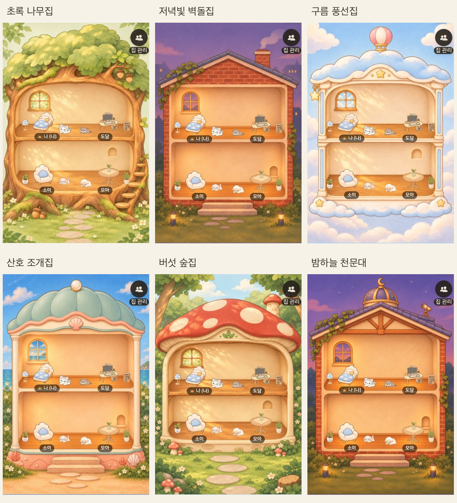

# 공동집 6종 리디자인 검증

- 관련 이슈: https://github.com/TripleS-soma/rougether-mobile/issues/1617
- 신규 2종: 초록 나무집, 저녁빛 벽돌집
- 리뉴얼 4종: 구름 풍선집, 산호 수족관 집, 버섯 숲집, 밤의 천문대 집

## 실제 앱 적용 화면

위 화면은 실제 HouseScreen, Room, CharacterAvatar와 실제 CDN 가구를 사용한 Expo 웹 캡처다. 멤버 이름과 배치 정보는 검증용 샘플이며, 운영 사용자 데이터나 네이티브 설치본을 확인한 자료가 아니다.

- [가구가 없는 상태](forest-empty.png)
- [1명 상태](forest-1.png)
- [10명 중 마지막 별채](forest-10-annex2.png)
- [개인 방 방문](member-visit.png)

## 동작과 호환성

집 화면에서는 현재 실제 배치한 가구 중 최대 2개와 캐릭터를 별도 contain 영역에 그린다. 벽지와 바닥을 포함한 개인 방 전체는 방문 시 기존 Room으로 보여준다. 4명 초과 시 본채와 별채로 나누고 실제 houseId와 membershipId를 보존한다. 같은 별채 안의 자리 교환 경로를 유지하며 별채 간 직접 드래그는 제공하지 않는다.

기존 4종 커버 키와 CDN 객체는 유지한다. 신규 2종의 원격 PNG는 구버전의 4개 투명 창문 규격을 유지하며 CDN 200과 바이트 해시 일치를 확인했다. 새 앱은 각 키를 번들된 개방형 그림으로 해석한다. 알 수 없는 커버와 EXPO_PUBLIC_HOUSE_DIORAMA=0은 기존 렌더러를 사용한다.

## 검증

- npm run typecheck, npm run lint, npm run format:check, git diff --check 통과
- 전체 Jest: 421개 묶음, 3,478개 테스트 통과, todo 4개, 실패 0개
- 명령: jest --watchman=false --runInBand --forceExit
- 테스트 완료 후 열린 핸들이 남아 --forceExit를 사용했다.
- Expo 웹에서 6종 전환, 가구 숨김, 1명, 10명 별채, 별채 멤버의 원래 방 방문을 확인했다.
- 네이티브 기기의 제스처와 실제 설치본 렌더링은 추가 확인이 필요하다.

Dev 갤러리의 HouseDioramaRenewal에서 인원 1/4/8/10과 가구 표시를 바꿔 확인할 수 있다. 이 변경은 서버 커버 카탈로그 신규 2종 추가와 연결되며 아직 운영 배포하지 않았다.

## Storybook과 마케팅 원본

Storybook의 에셋 → 공동집에 6종 카탈로그와 인원, 가구 조절판을 등록했다. 카탈로그에서 원본 PNG와 앱 WebP를 각각 내려받을 수 있다. design-assets/houses의 PNG는 가구와 캐릭터가 없는 1024×1536 배경이며 모바일 번들에는 추가하지 않는다.

새 스토리 7개는 Chromium 렌더링, play, 접근성 검사를 통과했다. 장식 이미지의 accessible=false만으로 웹 대체 텍스트가 생기지 않는 문제를 발견해 명시적인 빈 대체 텍스트를 추가했다. 다운로드 12개는 로컬 정적 빌드에서 HTTP 200과 manifest의 SHA-256 일치를 확인했다.

[Storybook 카탈로그와 다운로드 화면](storybook-catalog.png)

전체 Storybook Chromium 검사: 33개 파일, 97개 스토리 통과. 모바일 Jest: 421개 묶음, 3,478개 테스트 통과, todo 4개.
