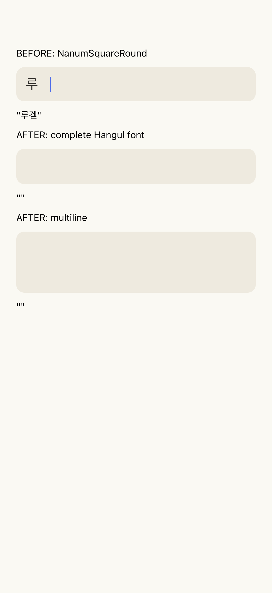
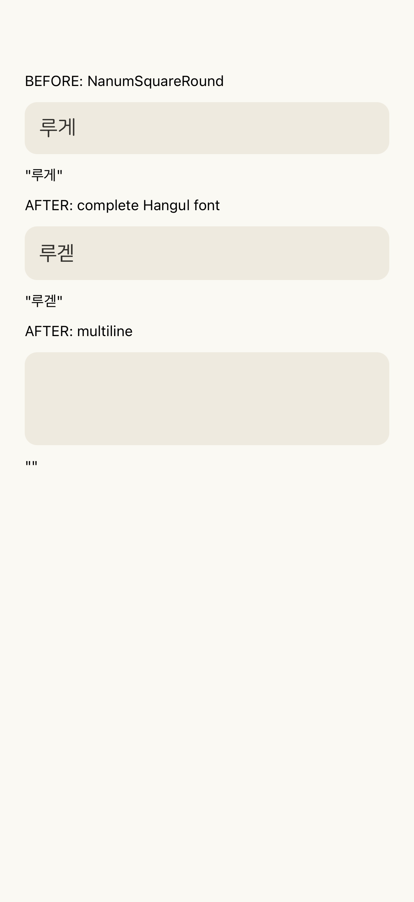

# 한글을 지우자 앞 글자도 사라진 이유, 입력 상태가 아니라 비어 있는 폰트 윤곽

- 날짜: 2026-11-11
- 영역: 공용 입력 UI, 폰트
- 관련 이슈: https://github.com/TripleS-soma/rougether-mobile/issues/1731
- 키워드: 한글 조합, 글리프 윤곽, cmap, 폰트 대체, 네이티브 재현

## 배경

습관 형성을 돕는 소셜 루틴 앱에서 아이폰 사용자가 프로필 닉네임을 입력하다 글자가 사라진다고 제보했다. 이후 확인한 조건은 iOS 27에서 `루게더`를 입력하거나 마지막 음절을 지우는 과정이었다. 다른 입력창도 같은 공용 폰트 정책을 사용했다.

## 문제

키보드가 `게`에 `ㄷ`을 붙이면 잠깐 `겓`이 된다. 이후 모음을 붙여 `게더`로 바꾸거나, 삭제하면서 반대 순서로 이 음절을 거친다. 이때 입력창에는 `루`만 보이고 뒤에 빈 공간과 커서가 남았다.

## 원인 분석

처음에는 React Native의 iOS 한글 조합 상태와 controlled value 동기화 충돌을 의심했다. 그러나 일반적인 조합과 삭제를 합성한 UIKit 테스트는 수정 전 코드에서도 정상 동작했다. 이 단계에서 라이브러리 이슈와 제보의 원인이 같다고 확정할 근거는 없었다.

사용자가 `루겓` 상태에서도 사라진다고 알려준 뒤 실제 폰트 파일을 조사했다. `cmap`에서 해당 문자가 등록됐는지만 보면 기본 폰트도 한글 전체를 지원하는 것처럼 보였다. `fontTools`의 `BoundsPen`으로 실제 윤곽까지 검사하자 결과가 달랐다.

| 폰트                      | 등록된 현대 한글 음절 | 실제 윤곽이 있는 음절 |
| ------------------------- | --------------------: | --------------------: |
| NanumSquareRound, 각 굵기 |                11,172 |                 2,479 |
| SUIT, 각 굵기             |                11,172 |                 2,668 |
| Jua                       |                 2,367 |                 2,367 |
| Pretendard, 각 굵기       |                11,172 |                11,172 |

기본 폰트의 `겓`은 글리프가 등록돼 있고 전진 폭도 910이나, 윤곽이 없었다. 따라서 운영체제의 다른 폰트로 대체되지 않고 빈 공간으로 그려졌다. 네이티브 재현에서도 입력값과 JS 상태는 `루겓`인데 화면에는 `루`만 보였다.

## 해결

입력창의 글꼴 선택만 공용 `AppTextInput`에 모았다. 윤곽이 불완전한 폰트는 기존에 앱에 포함된 Pretendard의 같은 의미 굵기로 대체한다. 입력 중에는 모든 현대 한글 음절을 그려야 하기 때문이다. 일반 화면의 선택 폰트 정책은 유지한다.

프로필, 가입과 온보딩, 루틴과 할 일, 집과 미션, 방명록, 피드와 댓글, 채팅, 신고, 검색과 숫자 입력을 포함한 모든 네이티브 입력 사용처를 공용 컴포넌트로 연결했다. 값, 이벤트, 선택 영역, ref와 길이 제한은 원래 TextInput에 그대로 전달한다. 값 동기화를 바꾸던 가설 단계의 수정은 제거했다.

웹은 선택한 폰트만 내려받으므로, 입력창이 요청할 대체 패밀리도 중복 없이 등록하도록 맞췄다. 폰트 파일과 네이티브 설정은 바꾸지 않았다.

## 검증

원본 캡처의 상단 입력창과 수정 캡처의 가운데 입력창을 비교한다. 입력값을 보여 주는 아래 문자열은 둘 다 `루겓`이지만, 실제 입력창의 글리프 표시가 다르다.

| 원본 폰트, 상단 입력창                                          | 수정 폰트, 가운데 입력창                                              |
| --------------------------------------------------------------- | --------------------------------------------------------------------- |
|  |  |

- iOS 27 네이티브 하니스에서 동일한 `루겓` marked text를 넣었을 때 원본 폰트는 빈 글리프를, 수정된 입력창은 정상 글자를 그리는 것을 확인했다.
- `루겓 → 루게더 → 루겓 → 루게`를 단일행과 여러 줄 입력에 적용해 네이티브 텍스트, JS 상태와 캡처를 비교했다. 실제 소프트웨어 키보드의 키 입력 자동화가 아니라 UIKit 조합 API를 사용한 재현이다.
- 회귀 검사는 폰트 파일 SHA-256과 실제 윤곽 감사 결과를 연결한다. 선택 가능한 모든 폰트와 굵기의 입력용 패밀리가 11,172자를 그리는지 확인한다.
- 기존 화면 테스트의 값과 초기화 검증을 그대로 유지하고 공용 입력창의 props, ref 전달 검사를 추가했다.
- Dev 갤러리의 `AppTextInput` 항목에서 같은 초안을 원본 폰트와 수정된 폰트로 나란히 비교할 수 있다. `루겓`을 불러오거나 직접 입력, 삭제하고, 비운 뒤 같은 글자를 다시 불러오는 순서로 확인한다.

검증은 코드와 로컬 네이티브 하니스 기준이다. 사용자 아이폰에 수정본을 배포한 결과와는 구분한다.

## 배운 점과 재발 방지

알려진 플랫폼 버그와 증상이 닮았더라도 입력값이 지워진 것인지, 값은 남아 있는데 글자만 안 그려지는 것인지 먼저 구분해야 한다. 폰트 지원 여부도 문자 매핑의 존재만으로 판단할 수 없다. 실제 윤곽과 전진 폭을 함께 검사해야 빈 글리프를 찾아낼 수 있다.

윤곽 감사는 다음 명령으로 다시 생성한다. 실행 환경에는 `fonttools`가 필요하다.

```bash
python3 scripts/audit-input-fonts.py > src/constants/input-font-coverage.json
```

## 후속: 다른 폰트와 모든 굵기 확인

사용자의 추가 요청으로 폰트 파일 12개와 iOS 시스템 폰트 1개를 다시 검사했다. 전체 한글의 실제 윤곽 감사를 재실행한 결과는 기존 JSON과 일치했다. 추가로 iOS 27에서 원본 폰트와 같은 입력용 대체표를 적용한 UIKit 입력창을 나란히 만들고, `루겓겍`을 비교했다. CoreText의 실제 폰트 대체 결과도 따라가며 각 글리프의 윤곽과 `.notdef` 여부를 확인했다.

| 원본 폰트        | 굵기 수 | 원본 `루겓겍`의 윤곽                          | 수정 후         |
| ---------------- | ------: | --------------------------------------------- | --------------- |
| NanumSquareRound |       3 | 3글자 중 1글자만 표시                         | 3글자 모두 표시 |
| SUIT             |       4 | 3글자 중 1글자만 표시                         | 3글자 모두 표시 |
| Jua              |       1 | 미등록 음절은 iOS 폰트 대체로 3글자 모두 표시 | 3글자 모두 표시 |
| Pretendard       |       4 | 3글자 모두 표시                               | 3글자 모두 표시 |
| iOS 시스템       |       1 | 3글자 모두 표시                               | 3글자 모두 표시 |

주아의 미등록 글자는 기본 폰트와 SUIT의 빈 글리프와 다르다. 미등록이면 iOS가 다른 폰트로 그릴 수 있지만, 폭만 가진 빈 글리프가 등록돼 있으면 그 글리프가 선택돼 공백으로 남는다. 수정 후 13개 비교 항목은 모두 3글자 전체에 윤곽이 있었고 `.notdef` 글리프는 없었다. 코드의 대체표는 이미 이 폰트들을 포함하고 있어 추가 동작 변경은 필요하지 않았다.

- [iOS 전체 폰트 비교 캡처](images/2026-11-11-input-font-all-faces.png)
- [네이티브 글리프 검사 결과](images/2026-11-11-input-font-all-faces.json)
